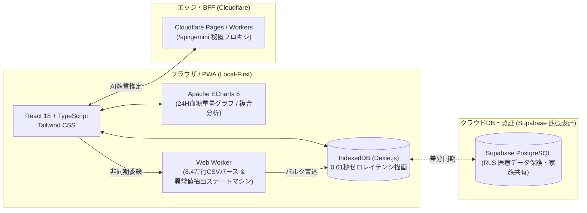

# リブレ・食事・インスリン統合管理システム Web版 (CGM Diabetes Manager PWA)

持続血糖測定器（CGM: FreeStyleリブレ）の連続グルコース測定データ（実測 79,479件：2024年9月〜2026年8月）と、日々の食事・糖質量・インスリン投与量・運動記録を統合管理・臨床分析する **Local-First マルチデバイス Web アプリケーション（PWA）** です。

---

## 1. 開発背景・目的（Excel VBA システムからの刷新）

従来、デスクトップ Excel マクロ（`main.xlsm`）で運用していた血糖値・食事管理システムには以下の課題がありました。

1. **大量データによる描画遅延とUIフリーズ**:
   - 15分間隔で記録される CGM 生データ（約8万行超）の読み込みや異常値集計時に Excel のメインスレッドが数秒〜十数秒フリーズする。
2. **外出先（スマートフォン）での記録・家族見守りの困難さ**:
   - 外食時の食事・インスリン記録や、離れた家族による血糖コントロール状況の確認が PC 上の Excel ファイルに限定されていた。

これらを解決するため、**「IndexedDB (Dexie.js) による 0.01秒の超高速ローカル描画」** と **「Web Worker による非同期CSVパース＆ステートマシン異常値抽出」** を核としたモダンな Local-First PWA アーキテクチャへ完全刷新しました。

---

## 2. 主な機能と画面構成（解説動画・デモウォークスルー対応）

本番環境（`VITE_APP_MODE=personal`）とポートフォリオ公開環境（`VITE_APP_MODE=portfolio`）で **100%同一のUIコンポーネント・臨床計算ロジック・実測血糖値データ** が動作します。ポートフォリオ環境では、閲覧者が食事記録・食品登録・活動登録・編集・削除をすべてインタラクティブに試せる一方、ページ再読み込み時には永続保存されず初期状態へ自動リセットされます。

| 画面・機能 | 概要・注目ポイント | 詳細仕様書 (SSOT) |
| :--- | :--- | :--- |
| **① 月間カレンダー & 24Hスパークライン** | ・各日の「平均血糖値」「合計糖質」「合計インスリン」「低血糖(`▼`)/高血糖(`▲`)回数」と **24時間血糖波形スパークライン** を1画面で俯瞰<br>・目標血糖範囲の設定閾値とリアルタイム連動 | [`SPEC_CALENDAR.md`](docs/Web_Project/SPEC_CALENDAR.md) |
| **② 日次詳細ドロワー & 24時間血糖重畳グラフ** | ・Apache ECharts による 00:00〜24:00 連続血糖曲線<br>・食事(`●`)・運動時間帯バンド(`◆`)・高血糖(`▲`)・低血糖(`▼`)の**垂直ドロップ破線**を重畳表示<br>・各食事カードに **「🩸食前 X → ピーク Y (+Δ)」** の血糖上昇幅を自動算出 | [`SPEC_CALENDAR.md`](docs/Web_Project/SPEC_CALENDAR.md) |
| **③ 食事・インスリン・活動記録 & 糖質自動推定** | ・登録済みメニューからのワンタップ呼び出しに加え、未登録料理も**日本食品標準成分辞書＋Gemini BFF連携**で糖質量を自動推定<br>・食事区分別のインスリン初期値プリセット機能 & 未保存変更の破棄防止ガード | [`SPEC_MEAL_RECORD.md`](docs/Web_Project/SPEC_MEAL_RECORD.md) |
| **④ よく使う食品・活動管理** | ・日常の食事メニュー（基準量・単位・糖質量）や運動メニューをカテゴリ別に整理・検索 | [`SPEC_FOOD_MASTER.md`](docs/Web_Project/SPEC_FOOD_MASTER.md) |
| **⑤ 4つの多角的データ分析** | 1. **食品別影響**：特定メニュー摂取時の食前→食後ピーク血糖値と平均上昇幅（+Δ）<br>2. **時間帯別傾向**：朝・昼・夕夜・夜間4区分の低血糖/高血糖発生分布<br>3. **曜日別傾向**：曜日ごとの血糖・糖質・インスリン比較<br>4. **糖質・インスリン推移**：日次の糖質摂取量・インスリン単位・平均血糖の3軸複合チャート | [`SPEC_ANALYSIS.md`](docs/Web_Project/SPEC_ANALYSIS.md) |
| **⑥ リブレCSV高速取込 (Web Worker)** | ・FreeStyleリブレ（LibreLink）の日本語/英語CSV（8.4万行超）を **Web Worker** で非同期パースし、UIを一切止めずに数秒で一括取込＆異常値エピソードを自動抽出 | [`SPEC_CSV_IMPORT.md`](docs/Web_Project/SPEC_CSV_IMPORT.md) |
| **⑦ 目標閾値カスタマイズ・データ保護・家族閲覧モード** | ・低血糖/高血糖閾値の変更時に過去全データを瞬時に再判定<br>・家族閲覧モード（`isReadOnly`）による誤編集・誤削除の完全ロック<br>・JSONフルバックアップ＆リストア対応 | [`SPEC_SETTINGS.md`](docs/Web_Project/SPEC_SETTINGS.md)<br>[`SPEC_PWA.md`](docs/Web_Project/SPEC_PWA.md) |

---

## 3. システムアーキテクチャ & 技術スタック



### 技術的なこだわり（面接・コードレビュー向けハイライト）
1. **実測血糖値データ（79,479件）の高速描画とステートマシン異常値抽出（[`src/lib/anomalyExtractor.ts`](src/lib/anomalyExtractor.ts)）**:
   - 合成されたサイン波デモデータは一切使用せず、FreeStyleリブレの実測データ（[`public/data/real_glucose_readings.json`](public/data/real_glucose_readings.json)）を使用。「28分以上の正常域継続でエピソード確定」「45分以上のセンサー欠損ギャップで区切り」という臨床ステートマシンにより、カレンダー・日次ドロワー・分析画面の全箇所で異常値件数が100%一致します。
2. **タイムゾーンズレ（-9時間問題）を根絶する Wall-Clock 日時エンジン（[`src/lib/dateUtils.ts`](src/lib/dateUtils.ts)）**:
   - `toISOString()` の UTC 変換によって「22時の夕食や就寝前インスリンが前日・翌日にズレる」問題を防ぐため、日時文字列の生成・比較・曜日判定をすべてローカル時刻基準のヘルパーに統一しています。
3. **5重の自動品質ゲートウェイ（[`docs/Web_Project/TEST_PLAN.md`](docs/Web_Project/TEST_PLAN.md)）**:
   - 仕様書とコードの同期・秘密情報検査・開発者用語排除（`npm run test:docs`）、厳格な型検査（`npm run typecheck`）、画面間データ整合性テスト（`npm test`）、チャンク最適化ビルド（`npm run build`）、および開発サーバー全28モジュールの実通信スモークテスト（`npm run test:smoke`）を Git フックと CI で自動化しています。

---

## 4. セットアップ & 起動コマンド

```bash
# パッケージのインストール
npm install

# 個人本番モードで開発サーバー起動 (永続保存: http://localhost:3000)
npm run dev

# ポートフォリオ公開モードで開発サーバー起動 (リロード時自動リセット・非永続化)
npm run dev:portfolio

# 5重品質ゲートの一括実行（仕様同期・型検査・単体/統合テスト・本番ビルド）
npm run verify:all

# 開発サーバーランタイムスモークテスト
npm run test:smoke
```

詳細な設計ドキュメント一覧は [`docs/Web_Project/README.md`](docs/Web_Project/README.md)、[`docs/Web_Project/ARCHITECTURE.md`](docs/Web_Project/ARCHITECTURE.md)、および解説動画・面接向けの工夫ポイントまとめ [`docs/Web_Project/VIDEO_PRESENTATION_HIGHLIGHTS.md`](docs/Web_Project/VIDEO_PRESENTATION_HIGHLIGHTS.md) を参照してください。
