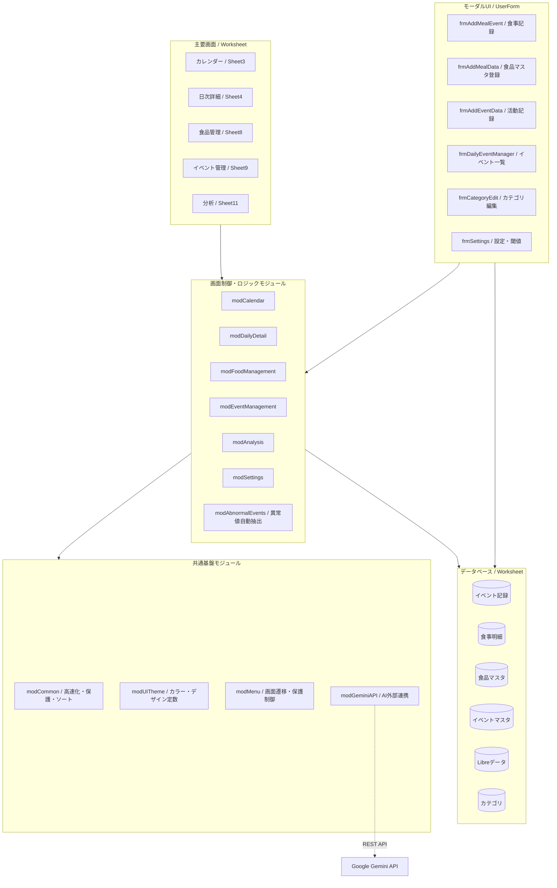

# 全体アーキテクチャ設計書 (ARCHITECTURE.md)

本ドキュメントは、Excel VBA 血糖値・食事・インスリン統合管理システム（`main.xlsm`）の全体構成、モジュール責務、データフロー、共通基盤を定義したアーキテクチャ仕様書です。

---

## 1. システム全体構成

本システムは、FreeStyleリブレ（CGM: 持続血糖測定器）の生データ（8.4万行超）と、患者の手動記録（食事、インスリン、活動）を統合し、臨床記録としての正確性を担保しつつ、モダンで直感的なUI（カレンダー、日次推移グラフ、多角分析、AI助言）を提供するExcel VBAデスクトップアプリケーションです。

---

## 2. モジュール一覧と責務マッピング

| モジュール名 | 区分 | 行数 | 主な責務・役割 |
| :--- | :--- | :---: | :--- |
| **`modCommon`** | 共通基盤 | 約150行 | **システム共通基盤**: 深度付き高速化制御（`BeginFastExecution` / `EndFastExecution`）、シート保護制御（`SafeProtect` / `SafeUnprotect`）、時刻ソート・変換ユーティリティ。 |
| **`modUITheme`** | 共通基盤 | 約580行 | **UIデザイントークン**: カラーパレット定数（SLATE, EMERALD, SKY, ROSE, AMBER等）、フォント、ボタン共通スタイル、Tag属性連携。 |
| **`modMenu`** | 共通基盤 | 約200行 | **ナビゲーション制御**: 画面遷移（カレンダー・日次詳細・食品・イベント・分析・設定）、共通シート保護ラッパー。 |
| **`modCalendar`** | 画面制御 | 約1,820行 | **カレンダー画面**: 月次グリッド構築、日別サマリーカード集計、スパークライン描画、イベントアイコン描画、月送り、カレンダーサイドメニュー。 |
| **`modDailyDetail`** | 画面制御 | 約2,320行 | **日次詳細画面**: 24時間血糖値推移グラフ描画（食事・異常マーカー重畳）、KPIサマリー、食事情報カード、イベント情報カード、スクロール制御、日送り、イベントソート（`SortEventLogSheet`）。 |
| **`modFoodManagement`** | 画面制御 | 約1,620行 | **食品管理画面**: 食品マスタカードレイアウト、カテゴリ一覧表示、動的行拡張、検索・フィルタリング、編集・削除導線。 |
| **`modEventManagement`** | 画面制御 | 約1,200行 | **イベント管理画面**: 活動マスタカードレイアウト、カテゴリ一覧表示、動的行拡張、検索・フィルタリング、編集・削除導線。 |
| **`modAnalysis`** | 画面制御 | 約2,350行 | **分析画面**: 月次/期間集計KPI、7大分析ビュー（食品別インパクト、曜日別傾向、時間帯別異常値、インスリン効果等）、動的期間切替、AI知見枠。 |
| **`modSettings`** | 業務ロジック | 約900行 | **設定・インポート**: 臨床閾値（低血糖<70、高血糖>180）、FreeStyleリブレCSV取込エンジン、データクレンジング。 |
| **`modAbnormalEvents`** | 業務ロジック | 約450行 | **異常値自動抽出**: リブレ15分値の生データから低血糖/高血糖エピソードを自動検知し、イベント記録シートへ一括書き込み。 |
| **`modGeminiAPI`** | 外部連携 | 約260行 | **AI連携**: Google Gemini REST API を呼び出し、食品名からの糖質量自動推定、および分析画面での臨床知見自動生成。 |
| **`modData`** | データ基盤 | 約260行 | **データ整合性**: テーブル初期化、インポート支援、データ整合性チェック。 |

---

## 3. ユーザーフォーム（モーダルUI）一覧

| フォーム名 | 画面サイズ (W×H) | 主な機能・役割 |
| :--- | :---: | :--- |
| **`frmAddMealEvent`** | 560 × 440 pt | **食事イベント登録・編集**: 食品マスタ検索・動的明細追加、数量変更による動的糖質計算、インスリン量入力、親子テーブル（イベント記録・食事明細）同時保存。 |
| **`frmAddMealData`** | 380 × 330 pt | **食品マスタ新規登録・編集**: 食品名、基準糖質量、標準単位、カテゴリ、Gemini APIによる自動推定ボタン。 |
| **`frmAddEventData`** | 380 × 320 pt | **活動イベント登録・編集**: 活動マスタ連動ドロップダウン、実施時刻、実施時間（分）、自由メモ入力。 |
| **`frmDailyEventManager`** | 620 × 460 pt | **日次イベント総合管理**: 指定日の登録イベント全件一覧表示（種別別カラーアイコン）、編集・削除・追加のハブ画面。 |
| **`frmCategoryEdit`** | 350 × 380 pt | **カテゴリマスタ管理**: 食品/活動カテゴリの追加・名称編集・削除（「未分類」保護ロジック内蔵）。 |
| **`frmSettings`** | 420 × 360 pt | **システム設定**: 低血糖/高血糖閾値、目標範囲、Gemini APIキー伏字入力・トグル表示。 |

---

## 4. 共通アーキテクチャ規約

### 4.1 パフォーマンス・高速化規約
1. **配列一括処理 (Array Memory Processing)**:
   数万行のLibreデータやイベントデータを扱う際は、セルアクセス（`Cells(r, c)`）を排除し、`Range.Value` で Variant 2次元配列に一括取得してメモリ上でループ処理を行う。
2. **高速化ラッパー (`modCommon.BeginFastExecution`)**:
   大量データ更新時は `Application.ScreenUpdating = False`, `Application.EnableEvents = False`, `Application.Calculation = xlCalculationManual` を適用し、処理完了後に `EndFastExecution` で確実に復元する。

### 4.2 シート保護・セキュリティ規約
1. **UserInterfaceOnly 保護**:
   全画面において、ユーザーのセル誤編集を防止しつつマクロからの安全な書き込みを許可するため、`UserInterfaceOnly:=True` の保護属性を採用する（`modCommon.SafeProtect`）。
2. **シート保護一時解除時の例外安全性**:
   構造変更（行挿入・削除等）で保護解除が必要な場合は、`SafeUnprotect` を呼んだ後、必ず `Finally` またはエラーハンドラで `SafeProtect` を実行し、保護が外れたままにならないようにする。

### 4.3 画面レイアウト・デザイントークン規約
1. **ハードコードRGBの排除とテーマ定数参照**:
   すべての色指定は `modUITheme` の定数（例: `COLOR_SLATE_800`, `COLOR_EMERALD_PRIMARY`, `COLOR_BORDER_GRAY`）を参照し、デザインの一貫性を保つ。
2. **コンテナ・カード構造**:
   各画面は「ヘッダーバー」「KPIサマリーカード」「メインコンテンツカード」「サイドバー」のコンテナ構造に統一され、カード外枠には 1pt 実線ボーダー（`COLOR_BORDER_GRAY`）と淡色背景（`COLOR_SLATE_50` / 白）を適用する。
