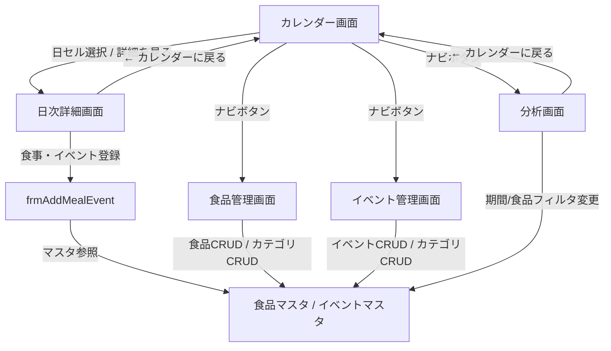

# 全体リファクタリング & 総合統合テスト 計画書
**プロジェクト**: Excel VBA 血糖値・食事・インスリン管理システム  
**作成日**: 2026年9月27日  
**対象ブック**: `main.xlsm`  
**ステータス**: **完了（全14テストケース合格・全画面最新化完了）**  

---

## 1. 目的とスコープ

本計画は、これまでに実装された各機能（統一デザインシステム、分析画面4大機能、直近3ヶ月の臨床データ投入、食品管理CRUD・カテゴリ管理、イベント管理CRUD・カテゴリ管理）を統合し、**システム全体の保守性・安定性・操作性を最高水準に仕上げるための最終リファクタリングおよび総合動作検証**を目的とします。

### 主なゴール
1. **画面UI/UXの完全統一**:
   - カレンダー画面の年月表示の不具合（`###`）解消
   - 全5画面（カレンダー、日次詳細、食品管理、イベント管理、分析）におけるナビゲーション操作の一貫性確保（統一3連ナビボタンの配置）
2. **VBAコードベースの健全化**:
   - 初期の自動生成名（`Module1`〜`Module7`）を責務に応じた命名（`modCalendar`, `modMenu` 等）へ整理
   - 未使用の一時検証コード・不要モジュール（`Module2`, `Module3`, `Module4`, `Module5`, `Module7`）の安全な削除
3. **総合統合テスト（End-to-End）の実施**:
   - 全画面・全機能間のデータ連携、画面遷移、フィルタ、マスタ更新がエラーなく動作することを自動・手動両面で網羅的に検証

---

## 2. リファクタリング詳細方針

### 2.1 VBAモジュール構成の再編

| 現在のモジュール名 | 実態・責務 | リファクタリング方針 | 変更後の名称 |
| :--- | :--- | :--- | :--- |
| **`Module6`** (648行) | カレンダー描画コア、月送り、スパークライン描画、Libre CSVインポート等 | カレンダーの中核機能。責務を明確にするためリネーム。 | **`modCalendar`** |
| **`Module1`** (55行) | メニューバーの表示・非表示切替マクロ | メニュー制御モジュールとしてリネーム。 | **`modMenu`** |
| **`Module2`** (24行) | 空のモジュール（宣言のみ） | 完全に不要なため安全に削除。 | *(削除)* |
| **`Module3`** (58行) | 初期の一時グラフ作成マクロ | 現在の `modDailyDetail` / `modAnalysis` で刷新済みのため安全に削除。 | *(削除)* |
| **`Module4`** (60行) | 初期の2軸グラフ作成マクロ | 現在の `modAnalysis` で刷新済みのため安全に削除。 | *(削除)* |
| **`Module5`** (88行) | 初期のCSV検証テストコード | 開発初期の使い捨てコードのため安全に削除。 | *(削除)* |
| **`Module7`** (131行) | 旧食品管理画面レイアウト構築マクロ | `modFoodManagement` に完全移行済みのため安全に削除。 | *(削除)* |

> [!NOTE]
> **依存関係の安全性**:
> 事前の全シェイプ `OnAction` 調査により、`Module2`〜`Module5`, `Module7` を参照しているシェイプやマクロ呼び出しは存在しないことを確認済みです。`Module6` のリネームに伴うカレンダー画面ボタン（`ShowPrevMonth` 等）の動作は、標準モジュールの Public Sub であるため完全互換が保たれます。

---

### 2.2 カレンダー画面（Sheet7）UIブラッシュアップ

1. **年月表示の調整**:
   - セル `B2:C2` 付近の年表示がセル幅不足により `### 8月` と表示されている現象を解消。
   - 列幅およびフォントサイズを最適化し、`2026年 8月` が美しく収まるように調整。
2. **統一3連ナビボタンの配置**:
   - カレンダー画面右上の旧ボタン（「ダッシュ」「分析画面」等）を撤去。
   - 他画面（日次詳細・食品管理・イベント管理・分析）と完全に同一の**統一3連ナビボタン（イベント管理 / 食品管理 / 分析）**を配置。
   - どの画面にいても、右上の同一位置・同一デザインのタブからワンクリックで目的の画面へ移動できるUIを実現。

---

## 3. 総合統合テスト（End-to-End）計画

システム全体のデータ整合性と画面間連携を、以下の5大ワークフローで網羅検証します。

### テストスイート項目

| No | テスト対象画面 | 検証項目 | 期待結果 |
| :---: | :--- | :--- | :--- |
| **T-1** | **カレンダー画面** | 月送り操作（前月・翌月・今月） | 2026年6月・7月・8月のデータが正常切り替え表示されること |
| **T-2** | **カレンダー画面** | 日セル選択 & 右側概要表示 | 選択した日付の糖質・インスリン・血糖・食事/イベント一覧が表示されること |
| **T-3** | **カレンダー ⇔ 日次詳細** | 「詳細を見る」ボタンクリック | 選択日の日次詳細画面に遷移し、血糖値グラフ・マーカーが描画されること |
| **T-4** | **日次詳細画面** | 「前日」「翌日」ボタン操作 | 日付が切り替わり、グラフと食事・イベントリストが正しく更新されること |
| **T-5** | **日次詳細 ⇔ カレンダー** | 「← カレンダーに戻る」クリック | カレンダー画面へスムーズに戻り、元の表示状態が維持されること |
| **T-6** | **食品管理画面** | 検索・カテゴリ絞り込み・クリア | キーワードおよびドロップダウンによる絞り込み・全件復元が機能すること |
| **T-7** | **食品管理画面** | 食品CRUD（新規・編集・削除） | `frmAddMealData` からの登録・変更・削除が食品マスタおよび一覧に即時反映されること |
| **T-8** | **食品管理画面** | カテゴリCRUD（追加・変更・削除） | `frmCategoryEdit` からのカテゴリ追加・変更・削除、既存データの安全移行が機能すること |
| **T-9** | **イベント管理画面** | 検索・カテゴリ絞り込み・クリア | キーワードおよびドロップダウンによる絞り込み・全件復元が機能すること |
| **T-10**| **イベント管理画面** | イベントCRUD（新規・編集・削除） | `frmAddEventData` からの登録・変更・削除がイベントマスタおよび一覧に即時反映されること |
| **T-11**| **イベント管理画面** | カテゴリCRUD（追加・変更・削除） | `frmCategoryEdit` からのカテゴリ追加・変更・削除、既存データの安全移行が機能すること |
| **T-12**| **分析画面** | 期間・対象食品変更時の自動集計 | 期間変更や食品選択時に4大分析グラフ・表がリアルタイムに再計算・描画されること |
| **T-13**| **全画面ナビゲーション** | 統一ナビボタン（3連タブ）の動作 | 全5画面間で、どの画面からも目的の画面へ確実に遷移できること |
| **T-14**| **VBAコンパイル検査** | 全モジュールの構文・型チェック | Compile Error、Syntax Error がゼロであること |

---

## 4. 実行手順（ロードマップ）

### フェーズ 1: カレンダー画面のUIブラッシュアップ【完了】
- 年月セルの幅・フォント微調整（`B2:C2`結合で年、`D2:E2`結合で月、`###` 完全解消）
- 旧ナビボタンの撤去および統一3連ナビボタン（イベント管理 / 食品管理 / 分析）の設置
- スクリーンショットによる美観確認

### フェーズ 2: VBAモジュール構成のリファクタリング【完了】
- `Module6` → `modCalendar` リネーム
- `Module1` → `modMenu` リネーム
- `Module2`, `Module3`, `Module4`, `Module5`, `Module7` の安全削除
- VBAコンパイル検査による整合性確認（Compile Error: 0件）

### フェーズ 3: 総合統合テストの自動実行【完了・全件PASS】
- テストスクリプト（`test_full_system_integration.py`）を実行
- 全14項目のテストケース（カレンダー、日次詳細、食品CRUD、イベントCRUD、カテゴリCRUD、分析自動集計、全画面相互ナビ、コンパイル検査）を全件合格（14/14 PASS）
- `docs/screenshot/` の全画面キャプチャを最新版に一括更新

### フェーズ 4: ドキュメント最新化 & Gitコミット【完了】
- `vba_exported/` ディレクトリへの全コンポーネント一括エクスポート同期
- Gitコミットの作成（変更内容の記録）

---

## 5. 安全性およびリスク管理

- **安全ランナーの徹底**: Excel COM 操作はすべて `safe_excel_runner.py`（タイムアウト監視・残留プロセス強制クリーンアップ）経由で実行します。
- **Git履歴保護**: 万一予期せぬ動作が発生した場合は、直前のコミット（`c8b0b1e`）へ即座にロールバック可能です。
- **データ不変性**: 臨床用ダミーデータ（`Libreデータ`、`イベント記録`、`食事明細`）はそのまま保持され、破壊されません。
