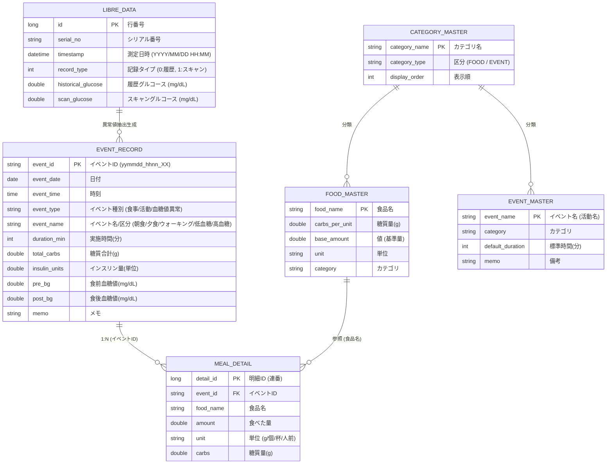

# データモデル仕様書 (SPEC_DATA_MODEL.md)

本ドキュメントは、Excel VBA 血糖値・食事・インスリン統合管理システム（`main.xlsm`）で管理される全ワークシート・テーブルのデータ構造、列定義、型、キー体系、および参照整合性制約を定義した仕様書です。

---

## 1. ER図・エンティティ相関

---

## 2. テーブル定義詳細

### 2.1 親テーブル: `イベント記録` (Sheet2)
患者の日々のイベント（食事・活動）およびリブレ生データから抽出された血糖値異常エピソードを一元管理する最重要テーブルです。

| 列番号 | 列名 (物理/論理) | データ型 | 必須 | 形式例 / 許容値 | 説明・制約 |
| :---: | :--- | :---: | :---: | :--- | :--- |
| **A (1)** | **イベントID** | 文字列 | ◯ (PK) | `261001_0646_01` `261001_2019_LOW01` | 主キー。形式: `yymmdd_hhnn_連番` または `yymmdd_hhnn_LOW01`/`HIGH01`。 |
| **B (2)** | **日付** | 日付 | ◯ | `2026/10/01` | イベント発生日。表示形式: `yyyy/m/d`。 |
| **C (3)** | **時刻** | 時刻 | ◯ | `06:46:00` | イベント発生時刻。表示形式: `hh:mm`。 |
| **D (4)** | **イベント種別** | 文字列 | ◯ | `食事`, `活動`, `血糖値異常` | 正規化された大分類。手動変更不可。 |
| **E (5)** | **イベント名/区分** | 文字列 | ◯ | `朝食`, `昼食`, `夕食`, `間食`, `低血糖`, `高血糖`, 活動名 | イベントの詳細名称・タイミング。 |
| **F (6)** | **実施時間(分)** | 数値 | - | `30`, `45` | 活動イベントの実施所要時間（分）。食事・異常値では空欄。 |
| **G (7)** | **糖質合計** | 数値 | - | `78.5` | 食事の総糖質量(g)。子テーブル（`食事明細`）の合計値と完全一致。 |
| **H (8)** | **インスリン量** | 数値 | - | `18` | 投与インスリン単位数。活動・異常値では空欄。 |
| **I (9)** | **食前血糖値** | 数値 | - | `120` | 食前測定血糖値(mg/dL)。活動・異常値では空欄。 |
| **J (10)** | **食後血糖値** | 数値 | - | `165` | 食後測定血糖値(mg/dL)。活動・異常値では空欄。 |
| **K (11)** | **メモ** | 文字列 | - | `最低 56 mg/dL (継続 91分)` 自由入力テキスト | 異常値イベントでは抽出エンジンが自動生成した測定情報、食事・活動ではユーザー自由メモ。 |

> [!IMPORTANT]
> **テーブル正規化に伴う注意点**:
> 2026年10月のリファクタリングにより、「実施時間(分)」が F 列（6列目）に新設され、従来の10列構成から **11列構成（A〜K列）** へ拡張されました。
> ソート処理（[`SortEventLogSheet`](file:///c:/Users/PC05/Documents/VBA/課題/anti_test/vba_exported/modDailyDetail.txt#L2290)）やデータ一括読み書き時は、必ず **`Range("A:K")`** の11列すべてを対象に処理しなければなりません。

---

### 2.2 子テーブル: `食事明細` (Sheet10)
食事イベント（親レコード）に含まれる各食品の明細データを管理する子テーブルです。

| 列番号 | 列名 | データ型 | 必須 | 形式例 | 説明・制約 |
| :---: | :--- | :---: | :---: | :--- | :--- |
| **A (1)** | **明細ID** | 長整数 | ◯ (PK) | `1`, `2` | 自動採番される一意の連番。 |
| **B (2)** | **イベントID** | 文字列 | ◯ (FK) | `261001_0647_01` | 親テーブル（`イベント記録`）のイベントIDと紐付く外部キー。 |
| **C (3)** | **食品名** | 文字列 | ◯ | `白米`, `味噌汁` | 食品マスタに登録されている食品名称。 |
| **D (4)** | **食べた量** | 数値 | ◯ | `1.5`, `100` | 摂取量。 |
| **E (5)** | **単位** | 文字列 | ◯ | `杯`, `g`, `個`, `人前` | 摂取単位。食品マスタの標準単位に準拠。 |
| **F (6)** | **糖質量** | 数値 | ◯ | `82.8` | 食べた量に基づき動的計算された糖質量(g)。 |

---

### 2.3 マスタテーブル: `食品マスタ` (Sheet6)
食事登録時に参照される食品の栄養情報マスタです。

| 列番号 | 列名 | データ型 | 必須 | 形式例 | 説明・制約 |
| :---: | :--- | :---: | :---: | :--- | :--- |
| **A (1)** | **食品名** | 文字列 | ◯ (PK) | `白米` | 食品名称（一意）。 |
| **B (2)** | **糖質量(g)** | 数値 | ◯ | `55.2` | 基準量あたりの糖質量。 |
| **C (3)** | **値 (基準量)** | 数値 | ◯ | `1` または `100` | 単位に対する数量基準（例: 1杯、100g）。 |
| **D (4)** | **単位** | 文字列 | ◯ | `杯`, `g`, `個` | 標準日常単位。 |
| **E (5)** | **カテゴリ** | 文字列 | ◯ | `主食`, `主菜`, `未分類` | カテゴリ名。未指定時は「未分類」。 |

---

### 2.4 マスタテーブル: `イベントマスタ` (Sheet7)
活動（運動・家事・入浴等）登録時に参照される活動種別マスタです。

| 列番号 | 列名 | データ型 | 必須 | 形式例 | 説明・制約 |
| :---: | :--- | :---: | :---: | :--- | :--- |
| **A (1)** | **イベント名** | 文字列 | ◯ (PK) | `ウォーキング` | 活動名称（一意）。 |
| **B (2)** | **カテゴリ** | 文字列 | ◯ | `有酸素運動`, `未分類` | 活動カテゴリ。 |
| **C (3)** | **標準時間(分)** | 数値 | - | `30` | フォーム起動時のデフォルト所要時間。 |
| **D (4)** | **備考** | 文字列 | - | `軽い散歩` | 補足情報。 |

---

### 2.5 測定ログテーブル: `Libreデータ` (Sheet1)
FreeStyleリブレから取り込まれた15分間隔の生グルコース測定ログです（約8.4万件）。

| 列番号 | 列名 | データ型 | 説明 |
| :---: | :--- | :---: | :--- |
| **A (1)** | ID | 整数 | 測定機器管理連番 |
| **B (2)** | 機器名 | 文字列 | デバイス名（`FreeStyleリブレLink` 等） |
| **C (3)** | シリアル番号 | 文字列 | センサー識別子 |
| **D (4)** | タイムスタンプ | 日時 | 測定日時（`yyyy-mm-dd hh:nn` または `yyyy/m/d h:mm`） |
| **E (5)** | 履歴グルコース | 数値 | センサー自動保存グルコース値 (mg/dL) |
| **F (6)** | スキャングルコース | 数値 | ユーザー手動スキャン時グルコース値 (mg/dL) |
| **G〜O** | 各種付加情報 | 文字列 | インスリン・食事メモ等（機器側記録） |

---

## 3. データ整合性・不変性制約（Clinical Data Integrity）

1. **イベント種別の不変性 (Immutability of Event Types)**:
   登録済みイベントの「種別（食事/活動/血糖値異常）」は編集不可とする。種別を変更する場合は「削除して新規作成」を原則とし、子テーブル（`食事明細`）の孤立・不整合を恒久的に防止する。
2. **システム自動生成ログの不可侵性 (Inviolability of Measurement Logs)**:
   リブレ生データから閾値（<70, >180）に基づき自動抽出された「血糖値異常」イベントは客観測定ログであるため、手動編集・削除をUI上で物理ロックする。
3. **カスケード削除の完全性 (Cascading Deletes)**:
   食事イベント（親レコード）を削除する際は、必ず同一 `イベントID` を持つ `食事明細` シートの全明細行を連動して物理削除する（[`modDailyDetail.DeleteDailyEvent`](file:///c:/Users/PC05/Documents/VBA/課題/anti_test/vba_exported/modDailyDetail.txt)）。
4. **親子糖質合計の完全一致 (Parent-Child Sum Consistency)**:
   食事イベントの「糖質合計（G列）」は、子テーブルの明細糖質量（F列）の総和と常に一致し、差が生じるような直接書き換えを禁止する。
5. **「未分類」カテゴリの保護**:
   カテゴリ削除時、所属していた食品・活動は自動的に保護カテゴリ「未分類」へ引き継がれ、孤立マスタを発生させない。
