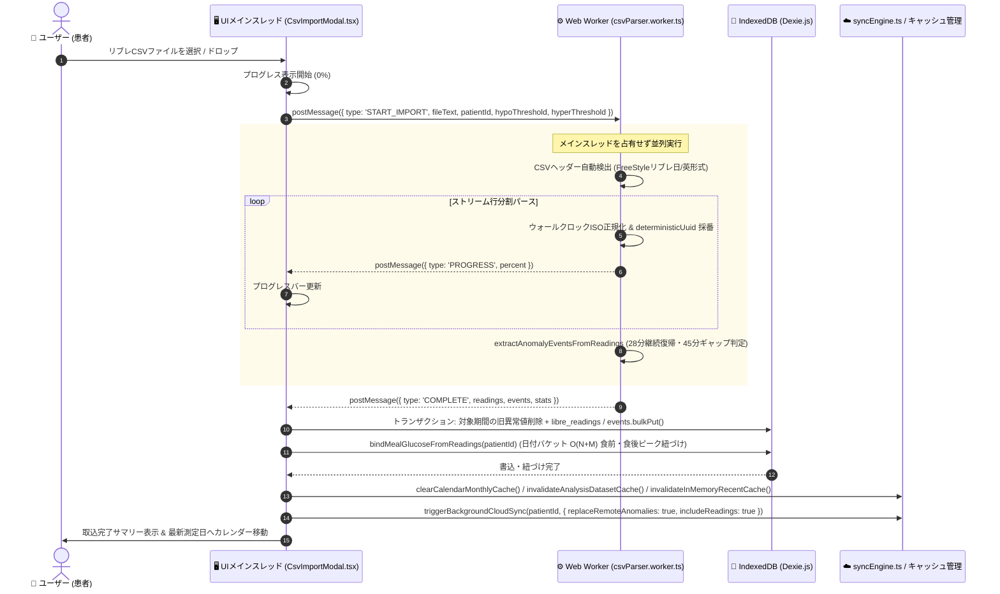
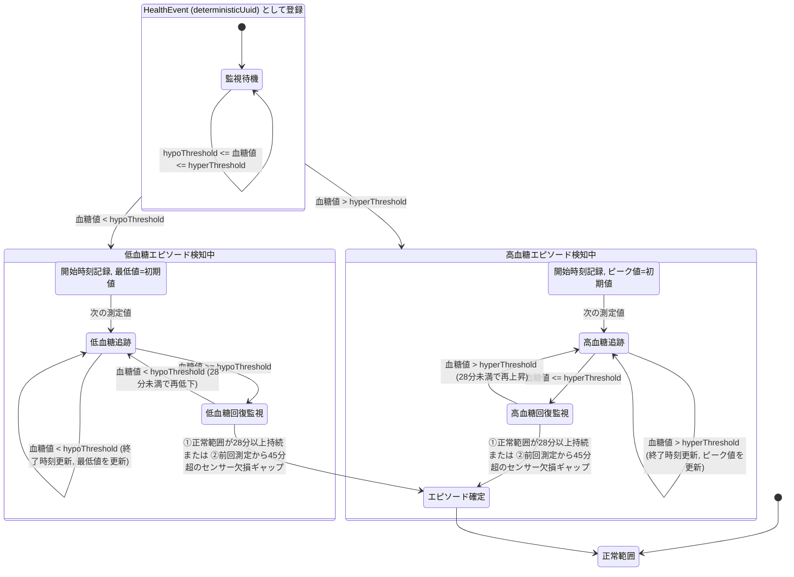

# リブレCSV取込 & 異常値イベント自動登録 処理フロー仕様書 (CSV_IMPORT_AND_ANOMALY_FLOW.md)

本ドキュメントは、8.4万件超のFreeStyleリブレ生データ（CSV）をWebブラウザ上でミリ秒単位で処理し、低血糖・高血糖イベントを自律的に抽出・登録するとともに既存の食事記録へ食前・食後ピーク血糖値を自動紐づけするパイプライン処理の設計図（SSOT: `src/components/import/CsvImportModal.tsx`, `src/workers/csvParser.worker.ts`, `src/lib/anomalyExtractor.ts`）です。

---

## 1. 全体処理アーキテクチャ (パイプライン概要)

大容量CSVパースおよび時系列ステートマシン判定をUIメインスレッドから完全分離し、**Web Worker**（`src/workers/csvParser.worker.ts`）に委譲することで、画面描画（60fps）を一切カクつかせずに高速実行します。Worker完了後、メインスレッド（`src/components/import/CsvImportModal.tsx`）でIndexedDBへの一括保存と食事血糖値バインド（`bindMealGlucoseFromReadings`）を実行します。

```mermaid
flowchart TD
    classDef ui fill:#e0f2fe,stroke:#0284c7,stroke-width:2px;
    classDef worker fill:#fef3c7,stroke:#d97706,stroke-width:2px;
    classDef db fill:#dcfce7,stroke:#16a34a,stroke-width:2px;
    classDef cloud fill:#f3e8ff,stroke:#9333ea,stroke-width:2px;

    subgraph UI_Thread ["【UIメインスレッド】 (CsvImportModal.tsx)"]
        A["ユーザー: CSVドラッグ&ドロップ / 選択"]:::ui --> B["ファイル検証 & テキスト読込"]:::ui
        B --> C["Web Worker 起動 & START_IMPORT 送信\n(fileText, patientId, hypoThreshold, hyperThreshold)"]:::ui
        M["進捗バー更新 (0% → 100%)"]:::ui
        N["カレンダー & サマリー・分析キャッシュ即時更新"]:::ui
    end

    subgraph Web_Worker ["【Web Worker (csvParser.worker.ts)】"]
        C --> D["独自高速ストリーム行分割CSVパーサー"]:::worker
        D --> E["リブレ生データ正規化 (ウォールクロックISO 8601 & deterministicUuid)"]:::worker
        E --> F{"時系列ソート済みデータ列"}:::worker
        F --> G["リブレ測定レコード生成 (LibreReading[])"]:::worker
        F --> H["異常値抽出ステートマシン (extractAnomalyEventsFromReadings)"]:::worker
        H --> I["低血糖エピソード判定 (< hypoThreshold, 最低値・継続時間)"]:::worker
        H --> J["高血糖エピソード判定 (> hyperThreshold, ピーク値・継続時間)"]:::worker
        I & J --> K["健康イベント生成 (HealthEvent[] / deterministicUuid)"]:::worker
        D -.->|定期 PROGRESS 通知| M
    end

    subgraph Local_Storage ["【ローカルデータベース & 食事血糖バインド】"]
        G & K -->|COMPLETE メッセージ返却| L1["対象期間の旧異常値置換 +\nlibre_readings / events.bulkPut()"]:::db
        L1 --> L2["bindMealGlucoseFromReadings()\n食前[-15〜+5分]・食後ピーク[+60〜180分]自動紐づけ"]:::db
        L2 --> N
    end

    subgraph Cloud_Sync ["【クラウド非同期同期 (syncEngine.ts)】"]
        L2 -.->|triggerBackgroundCloudSync\n(replaceRemoteAnomalies: true, 1,000件/chunk)| O["Supabase PostgreSQL (RLS保護)"]:::cloud
    end
```

---

## 2. 処理シーケンス図 (UI ↔ Web Worker ↔ Dexie.js ↔ Supabase)



---

## 3. 異常値抽出ステートマシンの臨床ロジック (State Machine Diagram)

旧VBA資産（`modAbnormalEvents.txt`）で培われた臨床エピソード判定アルゴリズムを忠実に再現し、`src/lib/anomalyExtractor.ts` の `extractAnomalyEventsFromReadings` に単一真実源（SSOT）として集約しています。設定画面（`db.user_settings` / `PatientContext`）のカスタム閾値（`hypoThreshold` デフォルト `70 mg/dL`、`hyperThreshold` デフォルト `180 mg/dL`）に連動し、**「エピソードとしての継続時間」および「最低値/ピーク値」** を追跡します。



### 3.1 臨床判定基準のまとめ
| 異常値種別 | 開始トリガー | 継続・更新条件 | 終了確定条件 | 登録されるイベントデータ |
| :--- | :--- | :--- | :--- | :--- |
| **低血糖イベント** | 血糖値 `< hypoThreshold`（標準 `< 70 mg/dL`） | `< hypoThreshold` が続く間、終了時刻を更新し最低値（`minVal`）を記録 | ①正常範囲（$\ge \text{hypoThreshold}$）に復帰後、**28分以上（約2測定）** 正常値が持続<br>②前回測定から **45分超のセンサー欠損ギャップ** が発生 | ・ID: `deterministicUuid("${patientId}_anomaly_低血糖_${lowStart}")`<br>・種別: `低血糖`<br>・開始日時: `lowStart`<br>・メモ: `最低 58 mg/dL (継続 45分間)` |
| **高血糖イベント** | 血糖値 `> hyperThreshold`（標準 `> 180 mg/dL`） | `> hyperThreshold` が続く間、終了時刻を更新しピーク値（`maxVal`）を記録 | ①正常範囲（$\le \text{hyperThreshold}$）に復帰後、**28分以上（約2測定）** 正常値が持続<br>②前回測定から **45分超のセンサー欠損ギャップ** が発生 | ・ID: `deterministicUuid("${patientId}_anomaly_高血糖_${highStart}")`<br>・種別: `高血糖`<br>・開始日時: `highStart`<br>・メモ: `最高 242 mg/dL (継続 90分間)` |

---

## 4. 既存データとの重複排除（冪等性保証）

同じCSVファイルを複数回取り込んだ場合や、日付が重複する過去データを取り込んだ場合でも、二重登録されないよう以下のキー（`src/lib/uuidUtils.ts`）で冪等性を保証します：

1. **測定値（`libre_readings`）**:
   - 主キーUUID: `deterministicUuid("${patientId}_${isoTime}")`、複合インデックス: `[user_id+timestamp]`
   - `bulkPut()` を用いることで、同一患者・同一日時のレコードは冪等に上書き（Upsert）され、件数が重複しません。
2. **異常値イベント（`events`）**:
   - 主キーUUID: `deterministicUuid("${patientId}_anomaly_${eventType}_${startTimestamp}")`
   - 取込対象期間（`startDate`〜`endDate`）内の既存自動抽出異常値イベントを `[user_id+event_datetime]` 複合インデックスで高速置換した上で `bulkPut()` するため、二重登録を100%防止します。
