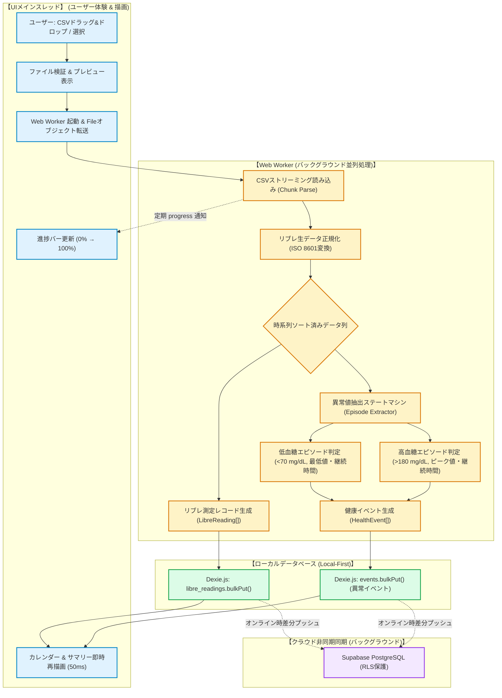
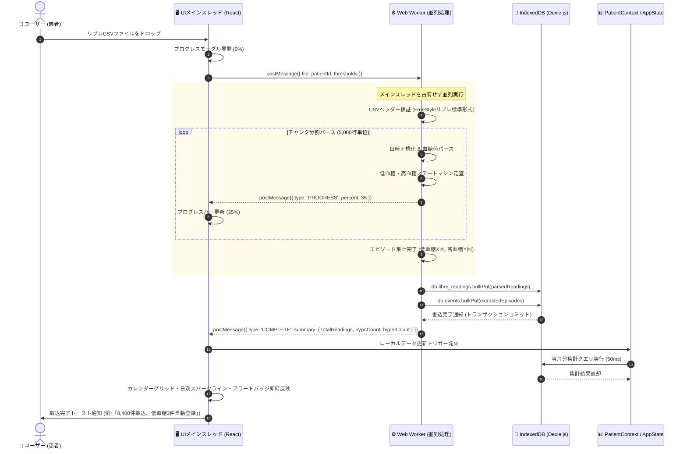
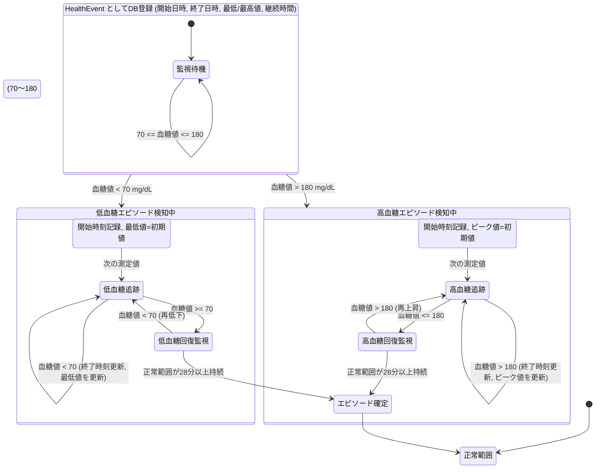

# リブレCSV取込 & 異常値イベント自動登録 処理フロー仕様書 (CSV_IMPORT_AND_ANOMALY_FLOW.md)

本ドキュメントは、8.4万件超のFreeStyleリブレ生データ（CSV）をWebブラウザ上でミリ秒単位で処理し、低血糖・高血糖イベントを自律的に抽出・登録するパイプライン処理の設計図（SSOT）です。

---

## 1. 全体処理アーキテクチャ (パイプライン概要)

大容量CSVパースおよび時系列ステートマシン判定をUIメインスレッドから完全分離し、**Web Worker** に委譲することで、画面描画（60fps）を一切カクつかせずに高速実行します。

---

## 2. 処理シーケンス図 (UI ↔ Web Worker ↔ Dexie.js)

---

## 3. 異常値抽出ステートマシンの臨床ロジック (State Machine Diagram)

旧VBA資産（`modAbnormalEvents.txt`）で培われた臨床エピソード判定アルゴリズムを忠実に再現します。単発の1測定だけでなく、**「エピソードとしての継続時間」および「最低値/ピーク値」** を追跡します。

### 3.1 臨床判定基準のまとめ
| 異常値種別 | 開始トリガー | 継続・更新条件 | 終了確定条件 | 登録されるイベントデータ |
| :--- | :--- | :--- | :--- | :--- |
| **低血糖イベント** | 血糖値 `< 70 mg/dL` | `< 70 mg/dL` が続く間、終了時刻を更新し最低値（`minVal`）を記録 | 正常範囲（$\ge 70$）に復帰後、**28分以上（約2測定）** 正常値が持続 | ・種別: `低血糖` ・開始日時: 最初の下落時刻 ・終了日時: 回復直前時刻 ・メモ: `最低 58 mg/dL (継続 45分間)` |
| **高血糖イベント** | 血糖値 `> 180 mg/dL` | `> 180 mg/dL` が続く間、終了時刻を更新しピーク値（`maxVal`）を記録 | 正常範囲（$\le 180$）に復帰後、**28分以上（約2測定）** 正常値が持続 | ・種別: `高血糖` ・開始日時: 最初の上昇時刻 ・終了日時: 回復直前時刻 ・メモ: `最高 242 mg/dL (継続 90分間)` |

---

## 4. 既存データとの重複排除（冪等性保証）

同じCSVファイルを複数回取り込んだ場合や、日付が重複する過去データを取り込んだ場合でも、二重登録されないよう以下のキーで冪等性を保証します：

1. **測定値（`libre_readings`）**:
   - 複合インデックス: `[user_id + timestamp]`
   - `bulkPut()` を用いることで、同一患者・同一日時のレコードは上書き（Upsert）され、件数が無駄に重複しません。
2. **異常値イベント（`events`）**:
   - エピソードIDルール: `${patientId}_${eventType}_${startTimestamp}` のハッシュまたは確定的UUID
   - 既存イベントと同一開始日時の異常値はスキップまたは更新され、二重登録を防止します。
