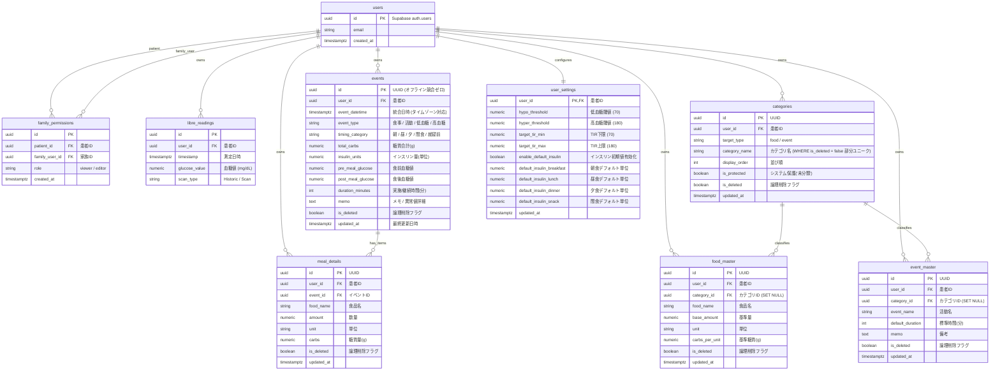
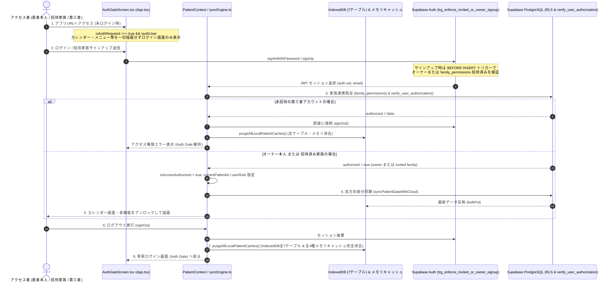
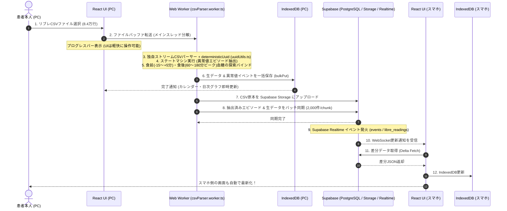
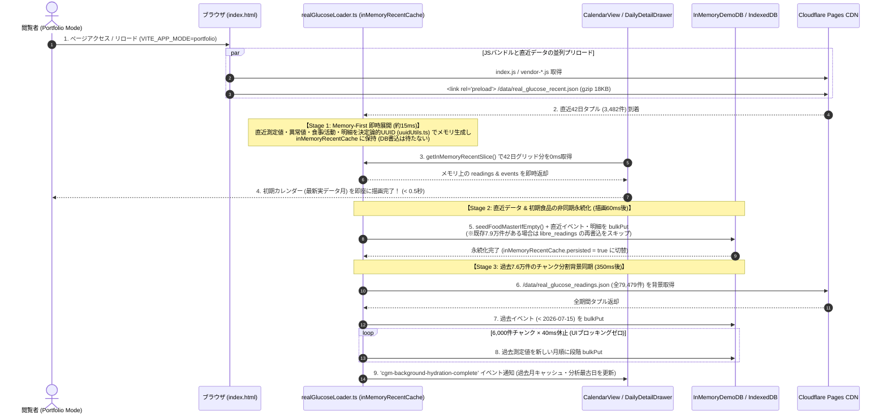

# Web版 シーケンス図 & データベースER図 (SEQUENCE_AND_ERD.md)

本ドキュメントは、システム内の重要処理フロー（家族共有認可、Local-First同期、CSVインポート）およびデータベースのエンティティ関係（ER図）をMermaid記法で可視化した仕様書です。
（※Phase 1 時点では IndexedDB (Dexie.js) ＋ 決定論的UUID (`src/lib/uuidUtils.ts`) ＋ Web Worker CSV取込 ＋ JSONバックアップ/復元が稼働中であり、Supabase Auth・PostgreSQL RLS・Delta Sync はクラウド接続フェーズで有効化されるターゲットシーケンスです。）

---

## 1. データベース ER図 (Entity Relationship Diagram)

本システムの PostgreSQL（Supabase）および IndexedDB（Dexie.js）で管理される全エンティティの関連図です。

---

## 2. 専用ログイン画面（Auth Gate）・招待専用ガード ＆ Supabase RLS 認可シーケンス

本番環境（`VITE_APP_MODE=personal` かつ Supabase 有効時）において、未ログイン時は `AuthGateScreen.tsx` のみを表示して第三者の閲覧を遮断し、ログイン時にオーナー本人または招待済み家族であることを検証した上でデータ同期を行い、ログアウト時にローカルキャッシュを全消去するフローです。

---

## 3. Local-First マルチデバイス同期 ＆ CSV取込シーケンス

PCでリブレCSVを取り込み、スマホへリアルタイム同期されるまでのバックグラウンド並列処理フローです。

---

## 4. ポートフォリオモード初回起動・リロード時の Memory-First 3段階段階的同期シーケンス (`src/lib/realGlucoseLoader.ts`)

ポートフォリオ公開モード（`VITE_APP_MODE=portfolio`）での初回アクセスおよびリロード時に、IndexedDB のディスクI/O待ちをバイパスして **0.5秒以内** にカレンダーを初期描画し、裏側で段階的に全79,479件をハイドレーションするデータフローです。
（※本番モード `VITE_APP_MODE=personal` では本シーケンスのデモJSON取得・ハイドレーションは一切実行されず、`seedFoodMasterIfEmpty(patientId)` のみが実行されます。）

