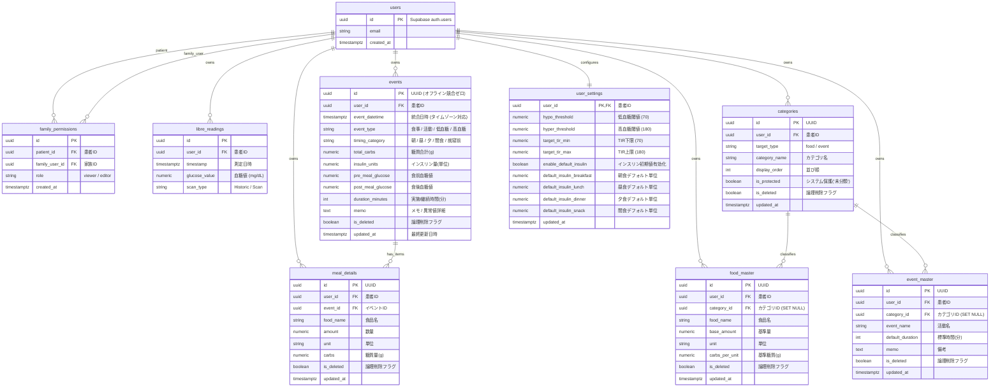
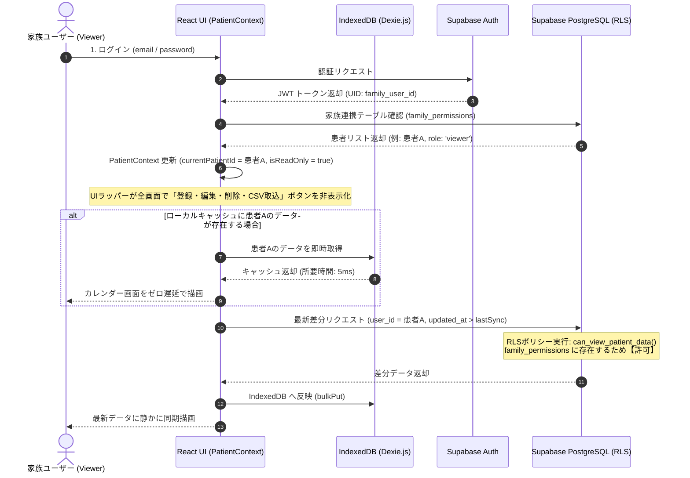
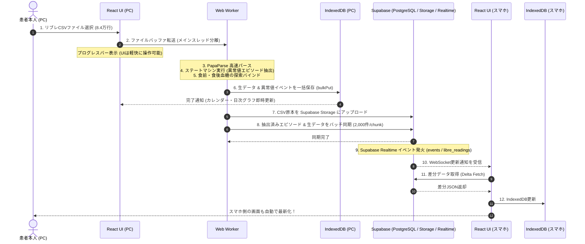
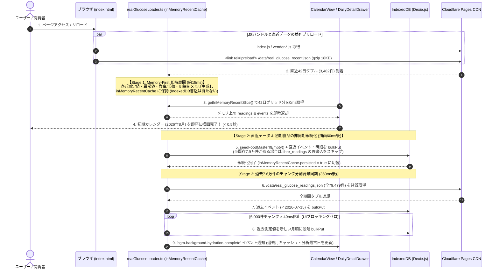

# Web版 シーケンス図 & データベースER図 (SEQUENCE_AND_ERD.md)

本ドキュメントは、システム内の重要処理フロー（家族共有認可、Local-First同期、CSVインポート）およびデータベースのエンティティ関係（ER図）をMermaid記法で可視化した仕様書です。

---

## 1. データベース ER図 (Entity Relationship Diagram)

本システムの PostgreSQL（Supabase）および IndexedDB（Dexie.js）で管理される全エンティティの関連図です。

---

## 2. 家族閲覧ロール ＆ Supabase RLS 認可シーケンス

家族がログインして患者の血糖値・食事データを閲覧する際の認可と表示制御のフローです。

---

## 3. Local-First マルチデバイス同期 ＆ CSV取込シーケンス

PCでリブレCSVを取り込み、スマホへリアルタイム同期されるまでのバックグラウンド並列処理フローです。

---

## 4. 初回起動・リロード時の Memory-First 3段階段階的同期シーケンス (`src/lib/realGlucoseLoader.ts`)

初回アクセスおよびポートフォリオモードでのリロード時に、IndexedDB のディスクI/O待ちをバイパスして **0.5秒以内** にカレンダーを初期描画し、裏側で段階的に全79,479件を永続化するデータフローです。

